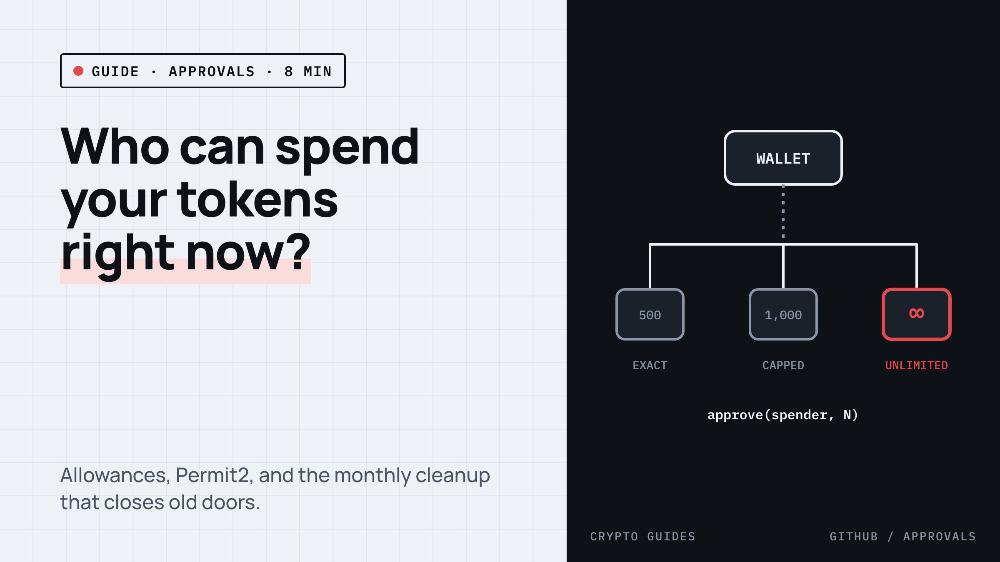
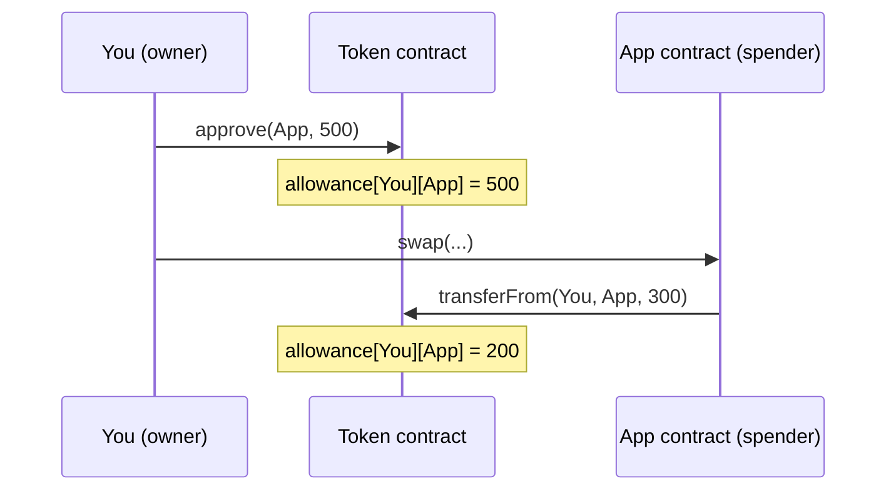
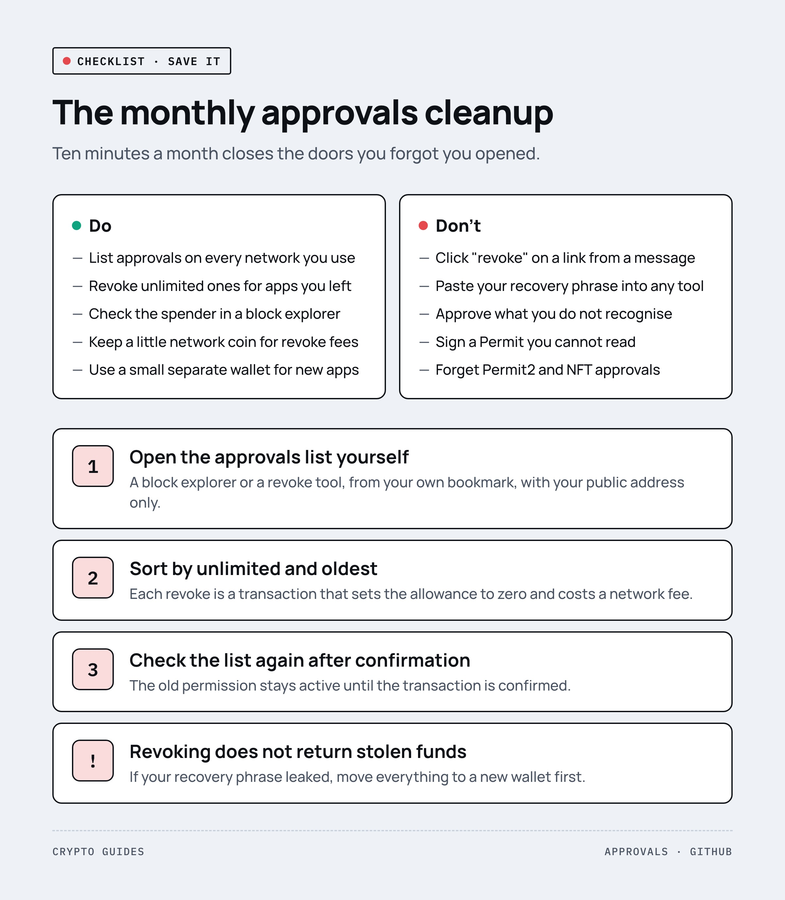

# Token approvals explained: who can spend your tokens right now?

**Every swap, stake and bridge leaves a permission behind. This guide shows how ERC-20 allowances work, how to list them, how to revoke them, and what revoking cannot fix.**



## Contents

- [The idea in one minute](#the-idea-in-one-minute)
- [How approve and transferFrom work](#how-approve-and-transferfrom-work)
- [Why apps ask for unlimited approvals](#why-apps-ask-for-unlimited-approvals)
- [Permit (EIP-2612) and Permit2](#permit-eip-2612-and-permit2)
- [NFTs: setApprovalForAll](#nfts-setapprovalforall)
- [How to list your approvals](#how-to-list-your-approvals)
- [How to revoke, and what it costs](#how-to-revoke-and-what-it-costs)
- [The monthly cleanup routine](#the-monthly-cleanup-routine)
- [What revoking does not fix](#what-revoking-does-not-fix)
- [Sources](#sources)

## The idea in one minute

On Ethereum and similar networks (BNB Chain, Base, Arbitrum, Polygon and the other EVM chains), a token is a
small program with a table of balances. A **contract cannot reach into your wallet** and take tokens. Instead, you
first tell the token: "this address may spend up to X of my tokens." That statement is an **approval** (or **allowance**).
Later, the approved address, usually a smart contract, pulls the tokens itself.

This is why a swap on a decentralised exchange is often two transactions: first "approve", then "swap". The approval is
not the swap. It is a standing permission, and it **stays on-chain until you change it**, even if you never use the app again.

An approval alone does not move your tokens. But if the approved contract has a bug, is upgraded maliciously or is
controlled by a scammer, the permission is the door they use.

## How approve and transferFrom work

ERC-20 ([EIP-20](https://eips.ethereum.org/EIPS/eip-20)) defines three functions behind this:

```solidity
approve(address spender, uint256 amount)               // you call this: set the allowance
allowance(address owner, address spender) -> uint256   // anyone can read it
transferFrom(address from, address to, uint256 amount) // the spender calls this
```



Key points:

- The allowance belongs to the pair **(you, spender)**, per token, per network.
- Each `transferFrom` reduces the allowance, unless it is "unlimited" (see below).
- Calling `approve` again **replaces** the value, it does not add to it.
- Approving costs a small network fee. Reading allowances is free.

<details>
<summary>Under the hood: unlimited means 2^256 - 1</summary>

An "unlimited" approval is just the largest possible `uint256`, `2^256 - 1`
(`0xffff...ffff`, 64 f's). Many token implementations treat that value specially and do not
reduce it on `transferFrom`, so it never runs out. Some tokens behave differently, so never assume.

Another quirk: the USDT contract on Ethereum requires an allowance to be set to `0` before it can be changed
to a different non-zero value. Wallets and apps work around this by sending a "reset to zero" transaction first.
</details>

## Why apps ask for unlimited approvals

An app that asks for a fresh approval before every swap costs you an extra transaction and extra network fees each time.
So many interfaces request the maximum once, to make later trades one click. It is convenient, and it also
means the contract can spend **your whole balance of that token**, now and in the future.

| | Exact amount | Unlimited |
|---|---|---|
| Extra transaction each time | Yes | No |
| Fees over time | Higher | Lower |
| Damage if the spender is compromised | Limited to that amount | Whole balance of that token |
| Good for | Rarely used apps, one-off actions | Established contracts you use often |

Many wallets let you edit the amount in the approval screen. Setting a custom amount equal to what you are about to
spend is the safe default. A permission you do not need is a permission you should not leave open.

## Permit (EIP-2612) and Permit2

**Permit ([EIP-2612](https://eips.ethereum.org/EIPS/eip-2612))** lets you approve with a **signature** instead of a transaction.
You sign a message off-chain ("owner X lets spender Y spend N until time T"), the app submits it, and the token
contract records the allowance. It saves a transaction and gas, and it has an expiry time. The catch: a signature
looks harmless in a wallet popup, yet it can grant a real spending permission. Scam sites ask for Permit signatures for exactly this reason.
Read what the request says, not just that it is "free to sign". Only tokens that implement EIP-2612 support it. USDC does,
and many others do not.

**Permit2** is a contract from Uniswap Labs, deployed at the same address on many networks
(`0x000000000022D473030F116dDEE9F6B43aC78BA3`). It works as a shared approval layer for tokens that have no Permit of their own:

1. You approve **Permit2** once for a token, usually unlimited (a normal ERC-20 approval).
2. Apps then ask you for a **signed permit** that names the real spender, an amount and an expiry.
3. Permit2 moves the tokens only when the signature is valid.

So Permit2 is two layers: an on-chain approval to Permit2 itself, plus time-limited sub-permissions underneath. When you
revoke, remember the first layer: an unlimited approval to Permit2 stays until you remove it. The second layer
expires on its own, and can also be reviewed and revoked in tools that support Permit2.

## NFTs: setApprovalForAll

NFTs ([ERC-721](https://eips.ethereum.org/EIPS/eip-721), [ERC-1155](https://eips.ethereum.org/EIPS/eip-1155)) have a broader permission:

```solidity
setApprovalForAll(address operator, bool approved)
```

It does not name a token or an amount. `approved = true` lets the operator move **every NFT you hold in that
collection**, including ones you buy later. Marketplaces need this to list your items for sale, which is normal. A
random site asking for `setApprovalForAll` on a collection you care about is the classic NFT-drainer pattern.
Revoking means calling the same function with `approved = false`.

## How to list your approvals

You need two things: a tool that finds approvals you have forgotten, and a habit of checking the right network.

- **Block explorers.** Etherscan has a Token Approval Checker, and explorers of other EVM networks (BscScan, Arbiscan, Basescan,
  Polygonscan and others) have equivalent pages. Open it, connect or paste your address, and read the list of spenders per token.
- **Revoke tools.** Web tools such as revoke.cash show allowances across many networks for any address you paste, and let you revoke.
- **Your wallet.** Some wallets list approvals inside the app. [Tint Wallet](https://tint.top/wallet/), for example, shows which contracts may spend your coins on Ethereum-family networks, and delegates on Solana, with a Revoke button. Check what your own wallet offers.
- **Your own script.** To check a specific token and spender, you can call `allowance(owner, spender)` yourself. This repo's companion script does it
  read-only: see the gist `check_allowances.py` (it needs only an address, never a key or a phrase).

<details>
<summary>Reading one entry in a list</summary>

- **Token**: what can be spent. Check the contract address, not only the name.
- **Spender**: the contract allowed to spend. Look it up in the explorer: is it verified, how old is it, which app is it?
- **Allowance**: a number, or "Unlimited".
- **Last updated**: old, unused entries are the first to revoke.
</details>

Paste only your **public** address into these tools. A site asking for your recovery phrase is a scam, always.

## How to revoke, and what it costs

Revoking is itself an on-chain transaction: it calls `approve(spender, 0)` (or `setApprovalForAll(operator, false)`). That means:

- **It costs a network fee**, paid in the network's own coin (ETH on Ethereum, and so on). The fee varies with network congestion: from
  a few cents on cheap networks to noticeably more on Ethereum during busy periods.
- **It takes effect when the transaction is confirmed.** Until then the old allowance is still active.
- **You need a little of the network's coin** in the wallet, even if the allowance is for a stablecoin.
- **Revoking is per spender and per token.** Ten approvals means ten transactions.
- You can **reduce** instead of revoking: setting a lower, non-zero amount also removes the unlimited risk.

Steps:

1. Open your tool or wallet's approvals list for the **right network**.
2. Sort by unlimited or by oldest. Revoke the ones you do not recognise or no longer use.
3. Confirm the transaction in your wallet and read the screen: it should say it is changing an allowance to zero.
4. Check the list again after the transaction is confirmed.

Do not use "revoke" buttons on random sites that reached you through messages or ads. Open the tool yourself.



## The monthly cleanup routine

Pick a date each month. It takes ten minutes.

- [ ] List approvals for every address you use, on every network you use
- [ ] Revoke unlimited approvals to apps you no longer use
- [ ] Revoke anything you do not recognise
- [ ] Revoke old Permit2 and NFT `setApprovalForAll` entries
- [ ] Check the spender in an explorer before keeping any approval
- [ ] Keep a small amount of the network coin for the revoke fees
- [ ] Use a separate wallet with small balances for trying new apps
- [ ] After revoking, check the list again

## What revoking does not fix

- **Funds that are already gone.** Revoking stops future spending. It does not return anything already moved. On-chain transfers are not reversible.
- **A compromised recovery phrase or private key.** If someone has your key, they do not need an approval: they are you. Revoking
  then does nothing useful. Move everything to a new wallet with a new phrase, most valuable assets first.
- **A malicious signature that has not expired.** Permit-type signatures can sit with an attacker until their deadline. If
  you suspect you signed one, spend or move the tokens first, because the allowance may only appear once the attacker submits it.
- **Approvals on other networks.** Each network has its own list.
- **Native coins.** ETH, BNB and the like are not ERC-20 tokens and are not spent through allowances.

If you think you signed something malicious: move the remaining assets to a fresh wallet first, then revoke, because moving is faster to
matter than revoking when a drain is in progress.

## Sources

- [EIP-20: Token Standard](https://eips.ethereum.org/EIPS/eip-20)
- [EIP-2612: Permit extension for EIP-20 signed approvals](https://eips.ethereum.org/EIPS/eip-2612)
- [EIP-721: Non-Fungible Token Standard](https://eips.ethereum.org/EIPS/eip-721)
- [EIP-1155: Multi Token Standard](https://eips.ethereum.org/EIPS/eip-1155)
- [Permit2 overview, Uniswap documentation](https://docs.uniswap.org/contracts/permit2/overview)
- [ethereum.org: ERC-20 token standard](https://ethereum.org/en/developers/docs/standards/tokens/erc-20/)
- [Etherscan Token Approval Checker](https://etherscan.io/tokenapprovalchecker)
- [revoke.cash](https://revoke.cash/)

---
Contributions and corrections are welcome — open an issue or a pull request.
License: CC BY 4.0. *Prepared with input from the Tint Wallet team.*
